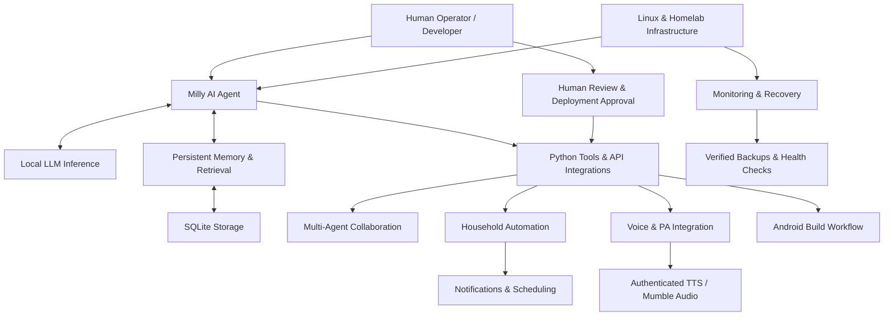

# Project Milly

### Self-Hosted AI Systems | Python Automation | Linux Infrastructure

**Developer:** Kevin Mays  
**GitHub:** [kevdarev711](https://github.com/kevdarev711)  
**Project Status:** Active Development  
**Focus:** AI Systems Integration · Python Automation · Linux Administration · Infrastructure Engineering

---

## Overview

**Project Milly is an independently developed, self-hosted AI assistant and automation ecosystem built across Linux servers, virtual machines, local language models, persistent databases, and connected devices.**

The project combines AI agent integration, persistent memory, automation workflows, remote system management, monitoring, and cross-platform application development.

I designed, integrated, troubleshot, tested, and maintain the ecosystem through a combination of independently written scripts, AI-assisted software development, technical research, and controlled deployment practices.

My work includes:

- Integrating locally hosted language models with Python-based tools and services.
- Developing persistent memory, semantic retrieval, and human-reviewed information workflows.
- Building automation tools using Python, Bash, SQLite, JSON, and HTTP APIs.
- Managing Ubuntu Linux systems, systemd services, SSH connections, Docker environments, and virtual machines.
- Implementing monitoring, backup verification, recovery workflows, and network diagnostics.
- Connecting Linux infrastructure to Android and Windows clients.
- Testing software changes, documenting failures, maintaining rollback procedures, and validating results before acceptance.

This repository presents **public-safe engineering case studies, runnable code examples, architecture documentation, and recorded verification evidence**.

Private operational systems, credentials, databases, and sensitive infrastructure configurations are intentionally excluded.

---

## Engineering Highlights

| Area | Demonstrated Work |
|---|---|
| AI Systems Integration | Self-hosted LLM inference, agent tools, persistent memory, semantic retrieval |
| Python Automation | Scheduled workflows, JSON state management, CLI utilities, subprocess integration |
| Linux Administration | Ubuntu, systemd, cron, SSH, service diagnostics, backup and recovery |
| API Integration | Authenticated HTTP services, notifications, distributed voice announcements |
| Infrastructure Monitoring | Health checks, network inventory, incident reporting, archive integrity |
| Software Testing | Regression checks, isolated test scenarios, fault handling, automated Python tests |
| Cross-Platform Integration | Linux-to-Windows audio delivery, Android application build workflows |
| Engineering Documentation | Architecture diagrams, tracked milestones, technical handoffs, change records |

---

## Featured Engineering Projects

### 1. Project Milly — Self-Hosted AI Agent Ecosystem

**Technologies:** Python, SQLite, local LLMs, KoboldCpp, Open Interpreter, Linux, SSH, tmux

Project Milly integrates self-hosted language model inference with persistent memory, retrieval, agent collaboration, and controlled tool execution.

Implemented and documented capabilities include:

- External persistent memory using SQLite-backed storage.
- Semantic retrieval and memory-recall workflows.
- Human-reviewed memory update processes.
- Communication and delegation between independently running AI agents.
- Linux tool execution and integration with external services.
- Model and tool compatibility testing, troubleshooting, and technical documentation.

The ecosystem remains under active development, with individual components at different levels of testing and acceptance.

**Technical documentation:**

- [Persistent AI Memory System](case-studies/persistent-memory.md)
- [Multi-Agent Collaboration](case-studies/multi-agent-collaboration.md)

### 2. Potato Command Center — Linux Infrastructure and Recovery

**Technologies:** Python, Bash, Ubuntu/Armbian, systemd, SSH, SHA-256, network utilities

Developed and integrated a Linux-based infrastructure management and recovery toolkit supporting a multi-device homelab.

Documented capabilities include:

- Infrastructure health checks and network device inventory.
- Automated Server1 configuration snapshots.
- Backup integrity verification and archive health reporting.
- Incident tracking and troubleshooting.
- Read-only archive retention classification.
- Authenticated web dashboard integration.
- ARM64 software packaging and deployment testing.

Historical verification includes successful unattended snapshot execution, integrity checks, and controlled recovery-related testing.

**Technical documentation:**

- [Potato Command Center — Engineering Case Study](case-studies/potato-command-center.md)
- [Potato Command Center — Verification Evidence](evidence/potato-command-center-verification.md)
- [SPUD Retention Scanner — Python Source and Tests](code-examples/spud-retention-scanner/README.md)

### 3. Milly Household Automation and Notifications

**Technologies:** Python, SQLite, JSON, Linux, cron, ntfy, authenticated HTTP APIs

Developed and integrated household coordination workflows using existing AI assistant and Linux infrastructure.

Features documented across development and testing include:

- Calendar and notification integrations.
- Persistent task and chore records.
- Recurring schedules and completion history.
- Automated reminder delivery.
- Authenticated mobile notifications.
- Duplicate prevention and state tracking.
- Human-controlled configuration and deployment.

The implementation reuses existing services instead of unnecessarily introducing new infrastructure.

**Technical documentation:**

- [Household Automation — Engineering Case Study](case-studies/Milly_Household_Automation_Case_Study_GitHub_Ready.md)

### 4. Milly Household PA — Distributed Voice Automation

**Technologies:** Python, Linux cron, flock, systemd, SSH forwarding, authenticated HTTP APIs, AllTalk TTS, FFmpeg, Mumble, Windows Task Scheduler

Integrated scheduled voice announcements across an existing distributed Linux and Windows audio infrastructure.

The implementation includes:

- A Python scheduler using approved JSON configuration.
- Persistent state tracking to suppress repeated announcement requests.
- Process locking through Linux `flock`.
- Authenticated announcement requests through an existing SSH tunnel.
- Text-to-speech generation and directed audio delivery through Mumble.
- A Windows listening endpoint with verified at-logon startup.
- Controlled pause/disable functionality and recovery procedures.

**Verification:** Integration testing and household audio acceptance were completed on 11/16/2026. A one-day operational pilot was scheduled for 11/17/2026; its results are not included in the current evidence.

The scheduler provides best-effort duplicate prevention. Successful queue acceptance does not independently guarantee audible playback.

**Technical documentation:**

- [Household PA — Engineering Case Study](case-studies/milly-household-pa.md)
- [Household PA — Verification Evidence](evidence/milly-household-pa-verification.md)
- [Household PA Scheduler — Python Demonstration and Tests](code-examples/milly-pa-scheduler/README.md)

### 5. AI-Assisted Android Development

**Technologies:** Android development tools, Linux, AI-assisted coding, application build workflows

Integrated AI-assisted software development with controlled Android application build and testing workflows.

Documented work includes:

- AI-assisted source modification and application development.
- Controlled application builds.
- Installation and testing on Android hardware.
- Troubleshooting build and integration issues.
- Maintaining human approval over significant development changes.

**Technical documentation:**

- [Android Development — Engineering Case Study](case-studies/android-development.md)

---

## System Architecture

The following diagram presents a simplified conceptual view of Project Milly and its connected engineering subsystems.

*Conceptual architecture only. Not every subsystem is directly controlled by an autonomous agent. Production boundaries, human approvals, and service-specific permissions remain important parts of the implementation.*

---

## Runnable Python Code Examples

These examples provide inspectable source code, documentation, and automated tests using sanitized or synthetic data.

| Project | Technical Focus |
|---|---|
| [SPUD Retention Scanner](code-examples/spud-retention-scanner/README.md) | Filesystem inspection, regex validation, timestamp processing, retention classification |
| [Household PA Scheduler](code-examples/milly-pa-scheduler/README.md) | Schedule matching, state tracking, subprocess integration, duplicate suppression |

Portfolio adaptations may differ from installed production implementations to remove private dependencies and enable isolated testing.

AI-assisted development is identified where applicable. Tests performed on standalone examples are distinguished from historical production-system verification.

---

## Technical Verification and Evidence

My engineering workflow emphasizes recording actual results, distinguishing simulated tests from live operations, and documenting unresolved limitations.

### System Health Verification — 11/11/2026

A documented system-health report recorded:

| Check | Reported Result |
|---|---|
| Overall health | PASS |
| Failures | 0 |
| Warnings | 0 |
| SQLite database integrity | 26 databases passed |
| Monitored core file integrity | 125 files matched accepted baseline |
| AI inference endpoints | Reachable |
| Backup status | Successful |
| Memory separation | Passed |
| Approval controls | Passed |

These results represent a point-in-time verification, not continuous uptime or comprehensive security certification.

[View System Health and Operational Verification](evidence/system-health-verification.md)

### Additional Engineering Evidence

- [Potato Command Center — Backup, Monitoring and Recovery Verification](evidence/potato-command-center-verification.md)
- [Household PA — Scheduling, Audio and Recovery Verification](evidence/milly-household-pa-verification.md)

Historical validation, mock testing, live audible demonstrations, and operational-pilot observations are labeled separately where relevant.

---

## Technical Skills

**Programming and Data**
- Python
- Bash and shell scripting
- SQL and SQLite
- JSON configuration and persistent state
- HTTP APIs and CLI integrations

**AI Systems**
- Self-hosted large language models
- KoboldCpp and Open Interpreter
- Agent integration and task delegation
- Semantic retrieval and persistent memory
- AI-assisted development and model behavior testing

**Linux and Infrastructure**
- Ubuntu Linux and ARM-based Linux systems
- systemd services and timers
- cron and process locking
- SSH and secure tunneling
- Docker and virtual machines
- Tailscale and local networking
- Backup monitoring and recovery workflows

**Engineering Practices**
- Git and GitHub
- Technical documentation and architecture diagrams
- Root-cause investigation and troubleshooting
- Automated and manual testing
- Regression verification
- Backup integrity validation
- Change management and rollback procedures
- Human-in-the-loop system administration

---

## Development and Testing Philosophy

I use AI-assisted development tools to accelerate research, code generation, debugging, and technical analysis while retaining responsibility for architecture, requirements, configuration, integration, testing, and final acceptance.

My approach prioritizes:

1. **Working implementations over unnecessary complexity.**
2. **Evidence-backed verification over unsupported claims.**
3. **Preserving functioning systems during development.**
4. **Human approval for significant configuration and deployment changes.**
5. **Clear records of failures, limitations, and recovery procedures.**
6. **Reusing existing components before introducing new services or infrastructure.**

AI-assisted development does not replace the need to understand, test, and maintain the resulting systems.

---

## About the Developer

I'm **Kevin Mays**, a self-directed AI systems developer and technical problem-solver based in Texas.

Before pursuing technology professionally, I spent approximately 11 years working for Burnet Consolidated Independent School District, progressing from warehouse and delivery operations into general maintenance and district locksmithing responsibilities.

My professional background includes hardware troubleshooting, electronic access-control systems, equipment maintenance, operational reliability, and technical problem-solving.

Through Project Milly and my broader homelab development work, I have expanded those skills into Linux administration, Python automation, AI systems integration, and software troubleshooting.

**I'm pursuing professional opportunities in AI automation, AI systems integration, Python development, Linux support, and technical infrastructure.**

---

## Project Status and Public Documentation

Project Milly is an actively developed collection of related systems rather than one finished commercial software product.

Some features are implemented and operationally tested, while others remain prototypes, under evaluation, or in continued development.

This public showcase intentionally excludes credentials, private databases, household details, sensitive network configuration, and internal operational records.

Documentation is updated as additional implementation and verification evidence becomes available.

---

**Kevin Mays**  
Independent AI Systems Developer  
[GitHub Profile](https://github.com/kevdarev711) | [Project Milly Showcase](https://github.com/kevdarev711/Project-Milly-Showcase)
