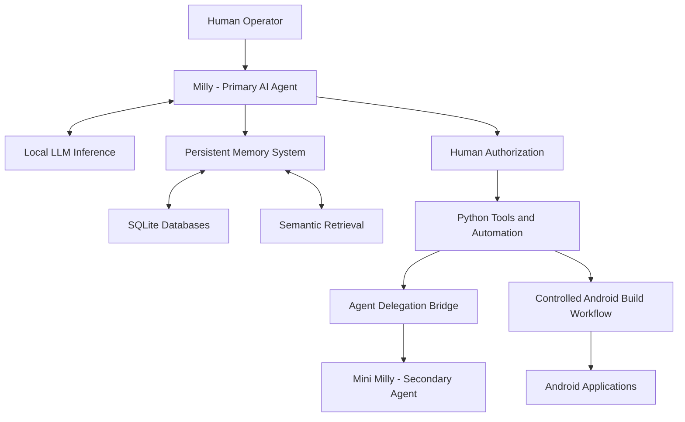

# Project Milly
### Self-Hosted AI Agent Ecosystem

**Developer:** Kevin Mays  
**GitHub:** [kevdarev711](https://github.com/kevdarev711)  
**Status:** Active Development

---

## Overview

Project Milly is an independently developed, self-hosted AI assistant ecosystem integrating local language models, persistent memory, agent collaboration, automation, and AI-assisted software development.

I designed and integrated the system using Linux infrastructure, Python tools, SQLite databases, and locally hosted language models.

My role includes system architecture, infrastructure configuration, AI-assisted development, debugging, integration testing, and ongoing maintenance.

This repository presents a public-safe technical overview. The operational environment, private data, and internal development documentation remain private.

## System Architecture

*Simplified conceptual architecture. Sensitive infrastructure details are intentionally excluded.*

## Featured Technical Work

### Persistent AI Memory

Developed and integrated a persistent memory architecture using SQLite, semantic retrieval, and human-reviewed memory updates.

Historical testing documented successful retrieval regressions and approval-control checks.

### Multi-Agent Collaboration

Established communication between independently running AI agents using SSH, Python automation, and persistent terminal sessions.

Demonstrated agent-to-agent message delivery, response retrieval, and secondary-agent tool execution.

### AI-Assisted Android Development

Integrated AI-assisted source development with a controlled Android build workflow.

Successfully built and installed Android applications, including the functional MillyTasks application.

## Technical Case Studies

- [Persistent AI Memory System](case-studies/persistent-memory.md) — SQLite memory architecture, semantic retrieval, and human-reviewed memory updates.

- [Multi-Agent Collaboration](case-studies/multi-agent-collaboration.md) — SSH-based delegation between two independently running AI agents.

- [AI-Assisted Android Development](case-studies/android-development.md) — Controlled Android builds and physical-device testing of MillyTasks.

## Technical Evidence

- [System Health & Operational Verification](evidence/system-health-verification.md) — Verified operational health, database integrity, backup recovery, and system monitoring results from 11/11/2026.

## Operational Verification

A system health check performed on **11/11/2026** reported:

| Verification | Result |
|---|---|
| Overall system health | PASS |
| Reported failures | 0 |
| Reported warnings | 0 |
| Database integrity | 26 databases passed |
| Core file integrity | 125 files matched baseline |
| AI inference endpoints | Reachable |
| Backup status | Successful |
| Memory separation | Passed |
| Approval controls | Passed |

These results represent a documented point-in-time health check, not a guarantee of continuous availability or comprehensive security certification.

## Technical Skills

**AI Systems:** Local LLMs, agent integration, persistent memory, semantic retrieval, AI-assisted development.

**Development:** Python, Bash, Git, SQLite, Android build integration.

**Infrastructure:** Ubuntu Linux, SSH, tmux, Docker, Tailscale, virtualization, systemd.

**Engineering Practices:** Troubleshooting, system integration, regression testing, human-in-the-loop approval, technical documentation.

## Development Approach

My work emphasizes practical system integration and verifiable results.

I use AI-assisted coding tools as part of the development process while retaining responsibility for requirements, architecture decisions, troubleshooting, integration, and acceptance testing.

The project remains under active development. Individual features have different levels of testing and maturity.

## About the Developer

I'm Kevin Mays, an independent AI systems developer with a background in technical maintenance, electronic access-control systems, and operational troubleshooting.

Project Milly represents my transition into AI systems development through hands-on experimentation, implementation, and testing.

I focus on building working systems, understanding their limitations, and improving them through documented development and verification.

---

**Kevin Mays**  
Independent AI Systems Developer
