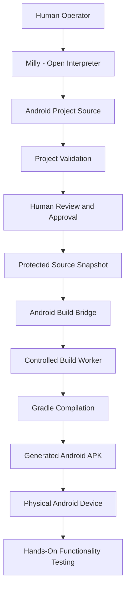

# Case Study 03 — AI-Assisted Android Development

**Project:** Project Milly  
**Developer:** Kevin Mays  
**Role:** AI Systems Development, Integration & Testing  
**Status:** Implemented and demonstrated; ongoing development  
**Technologies:** Kotlin, Jetpack Compose, Java, Android SDK, Gradle, Python, Ubuntu Linux, Open Interpreter, Git, systemd

---

## 1. Project Overview

Project Milly is a self-hosted AI assistant ecosystem designed to perform practical tasks through locally hosted language models, development tools, and automation.

One of my development goals was to expand Milly's capabilities beyond conversational assistance and enable her to participate in creating functional software applications.

I wanted Milly to help develop Android applications using her existing AI agent environment while maintaining human oversight of the software build process.

This resulted in an AI-assisted Android development workflow that successfully produced applications installed and tested on physical Android devices.

The project's primary demonstrated application was MillyTasks, a functional Android task-management application.

---

## 2. The Problem

AI agents can generate application source code, but generating code is not the same as successfully compiling and running software.

A functional Android development workflow requires several components:

- An installed Android SDK and build environment.
- Java and Gradle configuration.
- Valid Android project structures.
- Application source code.
- Dependency management.
- Compilation and build execution.
- Error diagnostics and troubleshooting.
- Testing on physical devices.

Additional challenges arise when the AI agent operates inside a restricted execution environment.

Milly's Open Interpreter environment intentionally limits certain operating system and network operations.

Direct Gradle builds from that environment encountered execution restrictions.

My objective was to enable practical Android development without removing the agent's existing security boundaries.

---

## 3. Development Environment

The documented development environment used the following technologies.

### AI Agent

**Open Interpreter**

Milly uses Open Interpreter to interact with authorized development tools and files.

A locally hosted language model provides the reasoning and code-generation capabilities.

### Operating System

**Ubuntu Linux**

The Android development toolchain operates within Milly's Linux environment.

### Android Development

**Android SDK**

Provides Android platform tools, build tools, and development resources.

**Kotlin and Jetpack Compose**

Used for the initial Android application projects.

**Java and Gradle**

Support compilation and build automation.

### Supporting Tools

**Python**

Used for development utilities, validation, build coordination, and automation.

**Git**

Used for source control and project checkpoints.

**systemd**

Used to manage supporting background services.

---

## 4. System Architecture

The workflow separates the AI agent's development activities from authorized Android build execution.

### AI-Assisted Development

Milly can create and modify Android project source files using her documented development tools.

These tools support development operations while preserving the agent's existing execution restrictions.

### Controlled Build Workflow

A dedicated build bridge coordinates requests between Milly's restricted environment and a separately managed build worker.

The documented architecture includes:

1. AI-assisted source development.
2. Project validation.
3. Preparation of a protected source snapshot.
4. Human authorization of a specific source version.
5. Submission of a build request.
6. Verification of the authorized source fingerprint.
7. Gradle compilation in a separate build environment.
8. Delivery of the resulting APK.
9. Installation and testing on a physical Android device.

The build worker checks whether the requested source snapshot has been approved.

Unauthorized build requests are rejected.

This workflow supports controlled development without granting the AI agent unrestricted access to the build environment.

---

## 5. Simplified Android Development Architecture

*This diagram illustrates the simplified development workflow. Internal infrastructure addresses, credentials, and sensitive configuration details are intentionally omitted.*

---

## 6. Applications Developed

Several Android projects were used to establish and validate the development workflow.

### MillyHello

MillyHello was an initial Android application used to demonstrate the development environment.

The application was created using Kotlin and Jetpack Compose.

The resulting APK was compiled, installed, and tested on a physical Android phone.

This established an initial working Android development capability.

### MillyNotes

MillyNotes was used during development of the controlled build workflow.

It served as a reference project for testing:

- Source validation.
- Protected project snapshots.
- Build authorization.
- Build request handling.
- Gradle compilation.
- APK generation.

The development records document successful controlled builds for MillyNotes.

### MillyTasks

MillyTasks was a more substantial Android development project.

The application was created through Milly's AI-assisted development workflow.

Documented capabilities included task-management functionality and an Android user interface.

The project demonstrated:

- AI-assisted application development.
- Source editing.
- Development tool integration.
- Git checkpoints.
- Controlled build execution.
- Successful APK generation.
- Installation on a physical Android device.
- Hands-on functionality testing.

I installed MillyTasks on my Android phone and confirmed that the application worked.

This provided direct evidence of a functioning application rather than compilation alone.

---

## 7. Implementation and Testing

The Android development system was expanded incrementally.

### Initial Toolchain Validation

The Android SDK, Java, and Gradle environment were installed and exercised.

Initial Android applications were used to validate project creation and compilation.

### Build Environment Restrictions

Direct Gradle builds from Milly's restricted Open Interpreter execution environment encountered operating system limitations.

The issue was investigated through diagnostics and comparisons between restricted and normal Linux execution environments.

The solution preserved the existing restrictions rather than globally disabling them.

### Dedicated Build Worker

A separate build worker was introduced to execute explicitly authorized build requests.

The system used protected source snapshots and SHA-256 fingerprints to identify approved source versions.

Build authorization was maintained separately from ordinary source editing.

### APK Delivery

The build workflow was extended to deliver completed APKs to a location accessible through Milly's development tools.

This reduced the need for manual artifact retrieval after authorized builds.

### Physical Device Testing

Applications were installed and launched on an Android phone.

The strongest demonstrated result was MillyTasks, which was successfully built, installed, and confirmed working.

---

## 8. Documented Verification Results

Historical development records include the following outcomes.

| Test Area | Documented Result |
|---|---|
| Android SDK and Gradle toolchain | Installed and exercised |
| Android project creation and editing | Demonstrated |
| MillyHello compilation | Successful |
| MillyHello installation | Confirmed working |
| Protected source validation | Successful |
| Unauthorized build rejection | Demonstrated |
| Authorized build execution | Successful |
| MillyNotes controlled build | Successful |
| MillyTasks APK generation | Successful |
| MillyTasks physical installation | Confirmed |
| MillyTasks functionality | User-confirmed working |
| Automated Android unit and UI tests | Not independently verified |

### MillyTasks Build Result

Development records document a successful MillyTasks APK build.

The build returned a successful status and produced an Android installation package.

The generated application was subsequently installed and tested on a physical phone.

This provided an end-to-end demonstration of the development workflow.

### Verification Boundaries

Successful compilation does not guarantee that every application feature works correctly.

Likewise, successful installation does not establish comprehensive automated test coverage or production readiness.

The documented results support the demonstrated functionality and build workflow.

They do not constitute a complete security audit of the build environment.

---

## 9. Technical Challenges and Lessons Learned

### Generating Code Is Different From Delivering Software

AI-generated application source code must still be compiled, tested, and validated.

This project required integrating the AI agent with real Android development infrastructure.

### AI Execution Boundaries Matter

An AI agent may have permission to edit project files without having unrestricted permission to execute build processes.

Separating development operations from controlled build execution provided a practical integration approach.

### Source Approval Requires Version Verification

Approving a build should identify the specific source version being authorized.

The workflow uses source fingerprints to distinguish approved snapshots from changed project files.

### Real Device Testing Provides Stronger Evidence

A successful build demonstrates that compilation completed.

Running the resulting application on a physical device provides additional evidence of practical functionality.

### AI-Assisted Development Still Requires Human Oversight

AI-generated code and implementation suggestions require review, troubleshooting, and validation.

Human decision-making remains important for architecture, integration, permissions, and acceptance testing.

---

## 10. Results and Project Impact

The Android development project demonstrated that a locally hosted AI agent could participate in a practical software development workflow.

The resulting system supported:

- Android project creation.
- AI-assisted source editing.
- Development tool integration.
- Source validation.
- Human-controlled build authorization.
- Gradle compilation.
- APK artifact delivery.
- Physical Android device testing.

MillyTasks provided a working application demonstrating the integration of these components.

The project expanded Milly's capabilities from general AI assistance into practical application development.

---

## 11. My Responsibilities

My role included:

- Defining development objectives.
- Selecting the integration approach.
- Coordinating AI-assisted implementation.
- Configuring the Android development environment.
- Troubleshooting build failures.
- Reviewing authorization and execution boundaries.
- Testing build workflows.
- Installing and testing generated applications.
- Maintaining technical development documentation.

This project involved AI-assisted source development rather than a claim that I manually authored every line of application code.

---

## 12. Limitations and Continuing Development

The Android development system remains an evolving project.

The documented implementation does not establish:

- Comprehensive automated unit-test coverage.
- Complete Android UI test coverage.
- Formal security certification.
- Production-ready application distribution.
- Universal compatibility with all Android projects.

Further development may include expanded application testing, additional build validation, and refinement of the development workflow.

---

## 13. Skills Demonstrated

This project demonstrates practical experience with:

- AI-assisted software development.
- Android development workflows.
- Kotlin and Jetpack Compose integration.
- Java and Gradle build environments.
- Python automation.
- Linux development environments.
- Git version control.
- Controlled build execution.
- Source verification using SHA-256.
- Troubleshooting and diagnostics.
- Human-in-the-loop authorization.
- Physical device testing.
- Technical documentation.

---

## Conclusion

The AI-assisted Android development project demonstrates my approach to turning AI-generated source code into functional software.

By integrating a locally hosted AI agent with Android development tools, controlled build execution, and physical device testing, I established a working development workflow.

The successful development and testing of MillyTasks demonstrates practical experience with AI systems integration, software development infrastructure, troubleshooting, and real-world validation.

---

**Kevin Mays**  
Independent AI Systems Developer  
Project Milly — Active Development
