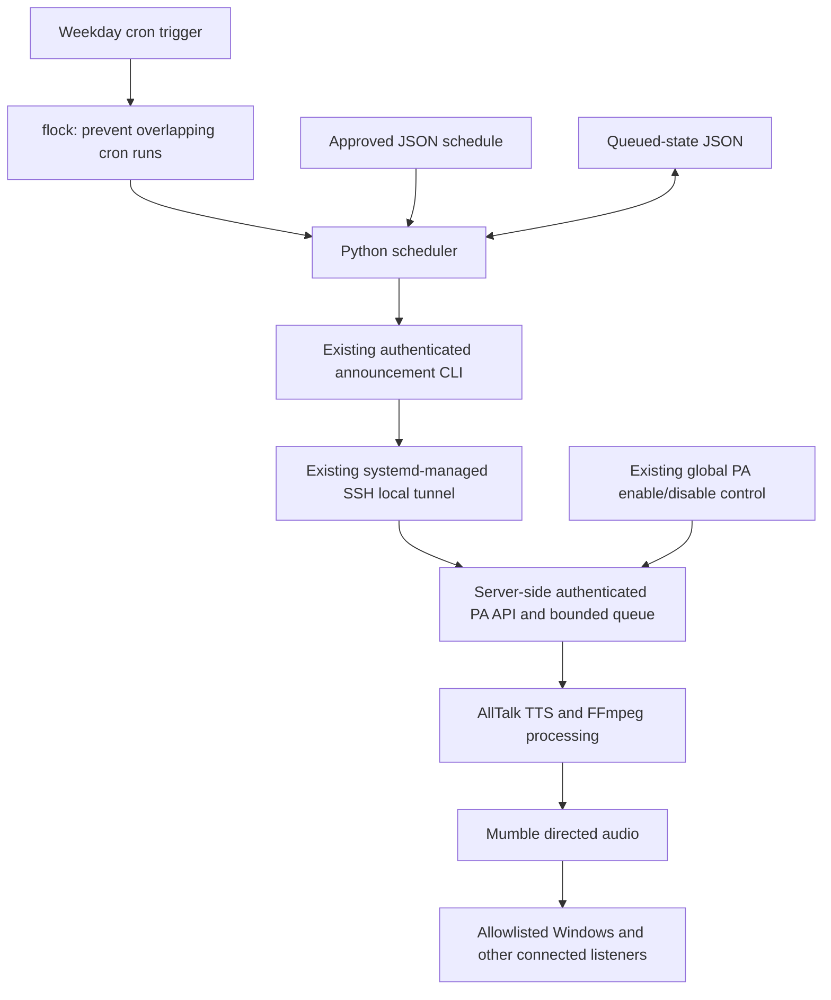

# Milly Household PA — Local AI-Integrated Voice Automation

**Project type:** Independent, AI-assisted engineering project  
**Role:** Kevin Mays — requirements, architecture decisions, controlled implementation, integration, verification, and acceptance  
**Status as of 11/16/2026:** Implemented; Phases 0–3 accepted. A one-day operational pilot is scheduled for 11/17/2026 and is **not yet completed**.  
**Relevant roles:** Junior AI Automation Engineer · AI Integration Specialist · Linux Support Engineer · Technical Support Engineer

## Engineering problem

A self-hosted assistant already had an authenticated voice-announcement path, but it lacked a narrowly scoped, predictable routine scheduler. The goal was to deliver five preapproved weekday announcements through existing local audio infrastructure **without replacing the voice stack, altering the separate household task/notification system, or giving an AI agent unrestricted deployment authority**.

The central engineering challenge was integration and operational control: reuse existing components; make scheduled behavior deterministic; prevent ordinary duplicate submissions; fail visibly rather than falsely reporting success; and preserve rollback options.

## Solution and architecture

A dedicated Python scheduler reads an approved JSON schedule, checks the current local weekday and minute, calls the existing authenticated announcement client when a configured occurrence matches, and records a queued marker after the client exits successfully. Linux cron starts it in approved time windows; `flock` prevents overlapping **cron-launched** executions. An existing systemd-supervised SSH tunnel connects the local client to a server-side authenticated PA API. The broadcaster synthesizes audio with AllTalk/FFmpeg and routes it to permitted Mumble listeners, including a Windows endpoint configured to start at interactive user logon.

**Technology stack:** Python 3, JSON, `zoneinfo`, Linux cron, `flock`, systemd, SSH port forwarding, authenticated HTTP/JSON, AllTalk TTS, FFmpeg, Mumble, Windows Task Scheduler.

**AI integration boundary:** This is an AI-connected voice-delivery system, but **scheduling is deterministic Python, not autonomous LLM decision-making**. Approval and privileged infrastructure changes remain under the project owner's control.

## Implemented behavior

- **Schedule matching:** Five approved announcements on weekdays, evaluated in the configured local timezone. Holidays follow the normal weekday schedule. No automatic or manual snoozing was implemented.
- **Best-effort duplicate prevention:** Each accepted occurrence is recorded using a date-and-announcement identifier in a JSON state file. A temporary file and atomic replace reduce partial-write risk; `flock` handles normal cron concurrency.
- **Delivery gate:** The Python process invokes the existing CLI. Only successful client exit results in a queued-state marker. Failed queue attempts do not create a false success marker.
- **Separation of concerns:** The new PA schedule runs independently of the established household chore/calendar/notification scheduler and its database. The existing broadcaster and audio services are reused.
- **Administrative control:** An existing authenticated, persistent global PA disable control rejects new announcements and affects manual PA output as well. Client-level volume remains outside the scheduler.
- **Endpoint management:** An approved Windows Mumble listening client is started via an at-logon task and connects to the existing Mumble server. An interactive login is required after a cold boot.

## Verification performed

The following results are **historical tests recorded on 11/16/2026**, not a new live-system audit:

| Test | Recorded result | Evidence type |
| --- | --- | --- |
| Python syntax and JSON configuration | Passed | Syntax/configuration checks |
| Five approved schedule matches and weekend exclusion | Passed | Dry runs with simulated times |
| Competing scheduled execution | Second run rejected | `flock` concurrency test |
| Repeated queue attempt for one occurrence | One mocked queue call; second attempt skipped | Isolated state/mock test |
| Authenticated PA access | Missing credentials rejected; authorized status accepted | HTTP behavior observed |
| Manual speech to a connected Windows listener | Audible output confirmed by Kevin | Live end-to-end observation |
| Temporary scheduled announcement | Successful test reported and accepted by Kevin | Controlled scheduled test; raw restoration log not supplied |
| Pause and resume | Disable rejected new queue request with HTTP 503; reenable succeeded | Live API control test |
| Controlled SSH tunnel restart | Tunnel returned active and PA API returned HTTP 200 | Controlled recovery test |
| Afternoon announcement sequence | Two announcements audibly confirmed | Immediate controlled simulation, **not** actual timed afternoon playback |

See [verification record](../evidence/milly-household-pa-verification.md) for precise scope and limitations. A [standalone Python demonstration](../code-examples/milly-pa-scheduler/README.md) is also available; it uses synthetic messages and **is not the production scheduler**.

## Design choices and limitations

1. **Queue acceptance is not audible playback:** An HTTP 202 means the server accepted the request into its queue. Actual playback depends on TTS, Mumble, connected listeners, and speakers; live audible tests were therefore performed separately.
2. **No exactly-once guarantee:** A crash after queue acceptance but before writing the local marker can allow a duplicate if retried. `flock` only protects invocations that use that lock. The implementation provides **best-effort duplicate prevention**, not a distributed transaction.
3. **Exact-minute processing:** An interruption during the configured minute may cause a missed announcement. There is no automatic catch-up, dead-letter queue, or eventual-delivery guarantee.
4. **Global PA disable:** This is not a schedule-only pause. It also blocks manual announcements and cancels queued jobs.
5. **Windows restart constraint:** The at-logon listener needs an interactive Windows login; automatic sign-in was deliberately not enabled.
6. **No extra features claimed:** No independent speaker-zone controls, server-side volume API, new quiet-hours subsystem, holiday exclusions, or snooze feature were added.
7. **Pilot pending:** The approved one-day operational observation is scheduled for 11/17/2026. No pilot reliability metrics or long-term availability claims are included here.

## Lessons and engineering ownership

This project illustrates pragmatic integration: inspect before building, reuse existing production services, introduce only one isolated scheduler, test both success and failure paths, and preserve an explicit way to disable new behavior. The development was AI-assisted, with Kevin responsible for decisions, controlled changes, testing feedback, and acceptance; this case study does not claim that all code was independently authored without assistance.

**Source basis:** Owner-maintained `fsp_Roadmap_Tracked.md` (11/16/2026 export) and the `Milly_Household_PA_Complete_Technical_Handoff_2026-11-16.md`. These are private project records; this page intentionally omits internal addresses, device/user identifiers, credentials, and personal schedules.
