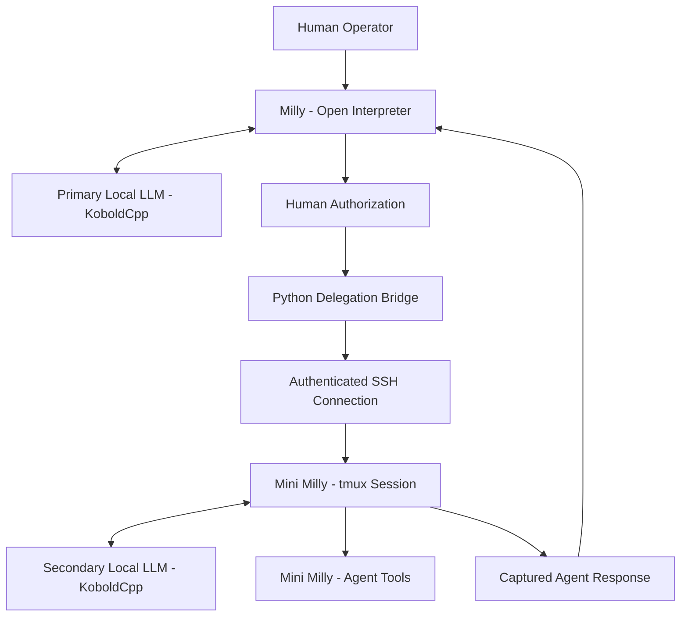

# Case Study 02 — Milly & Mini Milly: Multi-Agent Collaboration

**Project:** Project Milly  
**Developer:** Kevin Mays  
**Role:** AI Systems Development, Integration & Testing  
**Status:** Initial delegation bridge implemented and tested; continued development  
**Technologies:** Python, Ubuntu Linux, Open Interpreter, KoboldCpp, SSH, tmux, Local LLMs

---

## 1. Project Overview

Project Milly includes an experimental multi-agent architecture connecting two independently running, locally hosted AI assistants.

The primary AI assistant, Milly, operates in an Ubuntu Linux environment using Open Interpreter and a locally hosted language model.

A second assistant, Mini Milly, operates in a separate Ubuntu virtual machine with her own Open Interpreter environment and language model.

My objective was to establish a practical communication and delegation workflow between these agents while maintaining control over their execution permissions.

The initial system successfully demonstrated agent-to-agent communication, task submission, and response retrieval.

---

## 2. The Problem

A single AI agent has limitations involving computing resources, tool execution, and the ability to distribute work across different systems.

I wanted Milly to communicate with a second AI agent running on another computer.

However, communicating with a language model through an API is not the same as delegating work to a functional AI agent.

The system needed to interact with Mini Milly's existing Open Interpreter environment rather than simply generating text through her language model.

Additional challenges included:

- Establishing authenticated communication between separate Linux environments.
- Sending instructions to an existing interactive agent session.
- Retrieving completed responses.
- Handling execution timeouts and errors.
- Preserving human approval for authorized operations.
- Maintaining compatibility with the existing agent environments.

---

## 3. System Architecture

The implementation uses two independently running AI agents connected through an SSH-based delegation bridge.

### Primary Agent — Milly

Milly is the primary AI assistant.

Her environment includes:

- Ubuntu Linux
- Open Interpreter
- A locally hosted Gemma-based language model
- KoboldCpp inference
- Custom development and automation tools

Milly can initiate an authorized delegation request through a dedicated utility.

### Secondary Agent — Mini Milly

Mini Milly operates independently in a separate Ubuntu virtual machine.

Her environment includes:

- Ubuntu Linux
- Open Interpreter
- A locally hosted Ministral-based language model
- KoboldCpp inference
- An existing interactive tmux session

Mini Milly processes instructions through her agent environment rather than functioning solely as a text-generation endpoint.

### Delegation Bridge

A Python-based delegation utility coordinates communication between the two environments.

The documented bridge performs several operations:

1. Checks whether the delegation system is available.
2. Establishes an SSH connection to Mini Milly's Linux environment.
3. Verifies that the expected interactive agent session is ready.
4. Submits a bounded instruction.
5. Monitors the session for a response.
6. Retrieves the resulting terminal output.
7. Returns the captured response to Milly.

The system includes controls for concurrent execution and timeouts.

The initial implementation does not establish reliable autonomous multi-step software development or general-purpose distributed task management.

---

## 4. Simplified System Architecture

*This diagram describes the conceptual delegation workflow. It intentionally omits private network identifiers, credentials, and internal infrastructure details.*

---

## 5. Development and Integration

I developed the workflow through iterative experimentation, AI-assisted programming, Linux configuration, and direct testing.

### Agent Environment Configuration

The primary and secondary agents were configured to operate in separate Linux environments.

Each agent uses its own model inference backend.

This separation allows the agents to maintain independent execution sessions.

### SSH Communication

An authenticated SSH connection provides communication between the two Linux environments.

This allows the delegation utility to interact with Mini Milly's existing terminal session.

### tmux Integration

Mini Milly operates inside a persistent tmux session.

The delegation utility uses tmux to submit instructions and capture terminal output.

This preserves the existing interactive agent environment instead of launching a new model instance for every request.

### Tool-Calling Compatibility

During development, model configuration differences affected Mini Milly's ability to produce structured tool calls.

Testing identified a working configuration that allowed Open Interpreter to execute actual commands rather than merely generating tool-like text.

This was an important distinction because the objective was functional agent delegation, not simulated agent behavior.

### Authorization Boundaries

The primary agent's restricted execution environment was preserved.

Operations requiring access outside that environment remained subject to explicit human authorization.

The delegation bridge was not designed to grant unrestricted access to remote systems.

---

## 6. Testing and Verification

Historical development records document the following successful tests.

| Test | Documented Result |
|---|---|
| Secondary model API connectivity | Successful |
| Communication between Linux environments | Successful |
| SSH authentication | Successful |
| Remote tmux session interaction | Successful |
| Agent-to-agent message submission | Successful |
| Response capture and retrieval | Successful |
| Mini Milly executing an actual Linux command | Demonstrated |
| Delegation initiated through Milly | User-confirmed successful |
| SSH agent authentication fallback | Successfully tested |

### End-to-End Demonstration

A documented delegation test sent a specific response request through the bridge.

Mini Milly processed the request and returned the expected response.

Additional testing demonstrated that Mini Milly could execute a Linux command through Open Interpreter.

The final integrated delegation workflow was confirmed working by the project owner.

These tests establish functional communication and basic delegation.

They do not prove reliable autonomous multi-agent software development across complex tasks.

---

## 7. Technical Challenges and Lessons Learned

### Language Model Communication Is Not Agent Delegation

Calling a language model API can generate text, but it does not automatically provide access to an agent's tools.

The project required interaction with Mini Milly's actual Open Interpreter environment.

### Structured Tool Calls Require Compatible Configuration

Model-generated text that resembles a tool call is not proof that a tool executed.

Successful integration required examining structured tool-call behavior and verifying actual command execution.

### Execution Environments Have Different Permissions

Commands that work in a normal Linux terminal may fail inside a restricted AI execution environment.

The project demonstrated the importance of understanding execution boundaries rather than disabling restrictions for convenience.

### Terminal Output Is Not Proof of Task Success

Capturing an AI agent's response establishes that communication occurred.

It does not independently verify that every claim made by the responding agent is correct.

Further verification is necessary for complex delegated work.

---

## 8. Results

The project successfully demonstrated:

- Communication between two independently running local AI agents.
- Authenticated SSH-based delegation.
- Interaction with a persistent remote Open Interpreter session.
- Agent-to-agent message submission.
- Response retrieval.
- Actual tool execution by the secondary agent.
- Human-authorized execution boundaries.

The implementation established a foundation for continued experimentation with distributed AI agent workflows.

---

## 9. Limitations and Future Development

The initial bridge remains an experimental integration.

The documented tests do not establish:

- Reliable autonomous multi-step software development.
- Verified delivery of completed project files between agents.
- Robust concurrent delegation.
- Comprehensive recovery from remote failures.
- Guaranteed correctness of delegated task results.

These remain areas for possible future development and testing.

---

## 10. Skills Demonstrated

This project demonstrates practical experience with:

- Multi-agent AI architecture.
- Local LLM deployment and integration.
- Python automation.
- Linux system administration.
- SSH authentication and remote execution.
- tmux session management.
- Agent tool-calling integration.
- Debugging model compatibility issues.
- Human-in-the-loop authorization.
- End-to-end integration testing.
- Technical documentation.

---

## Conclusion

The Milly and Mini Milly delegation project demonstrates my approach to integrating AI systems across separate computing environments.

Rather than relying solely on language model API responses, I developed and tested a workflow that connects independently running tool-capable AI agents.

The project reflects practical experience with AI systems integration, Linux infrastructure, remote communication, troubleshooting, and verification.

---

**Kevin Mays**  
Independent AI Systems Developer  
Project Milly — Active Development
