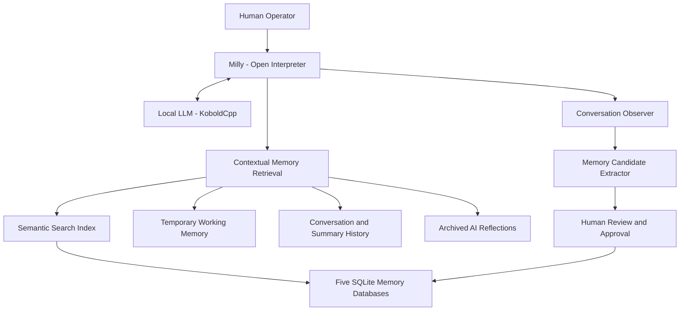

Case Study 01 — Milly's Persistent Memory System

Project: Project Milly
Developer: Kevin Mays
Role: AI Systems Development, Architecture, Integration & Testing
Status: Implemented and tested; ongoing development
Technologies: Python, SQLite, BGE-small Embeddings, llama.cpp, Open Interpreter, KoboldCpp, Ubuntu Linux, systemd

---

1. Project Overview

Project Milly is a self-hosted AI assistant ecosystem designed to combine local large language models with persistent memory, software development tools, automation, and agent collaboration.

One of the project's major technical challenges was developing a memory system that could preserve useful information between conversations without requiring the AI model to load its entire history into every prompt.

I addressed this challenge through an evolving architecture that combines structured databases, semantic information retrieval, background processing, and human-reviewed permanent memory updates.

The resulting system supports several forms of memory while maintaining distinctions between approved factual records, temporary context, historical conversations, and AI-generated reflections.

2. The Problem

Large language models operate within limited context windows. Without supporting systems, they can lose access to relevant information from earlier conversations.

For a persistent AI assistant, this creates several challenges:

- Remembering information across separate sessions.
- Finding relevant memories despite differences in wording.
- Preventing duplicate and conflicting information from accumulating.
- Distinguishing temporary conversational context from permanent facts.
- Preserving historical information without overwhelming the active model context.
- Maintaining human oversight of important memory changes.

My objective was to develop a practical, modular solution that could be expanded and tested incrementally.

3. System Architecture

The memory architecture uses multiple specialized components rather than relying on a single conversation-history file.

Structured Permanent Memory

Five SQLite databases organize persistent information into distinct categories:

Database| Purpose
Personal| Identity, preferences, and personal context
Infrastructure| Technical systems and configuration knowledge
Projects| Development projects, milestones, and decisions
Experiences| Troubleshooting history and lessons learned
Conversations| Selected historical interactions

These databases provide authoritative storage for approved long-term memories.

Semantic Retrieval

A local BGE-small embedding model converts text into numerical vectors.

A separate semantic index allows related memories to be retrieved based on meaning rather than exact keyword matches.

The semantic index functions as a searchable cache. The underlying SQLite memory databases remain authoritative.

Automated Memory Processing

Background components observe completed conversations and identify potential information worth preserving.

An extraction process proposes memory candidates for review.

Candidates are not automatically promoted into permanent factual memory.

Human Review and Approval

A review workflow allows proposed memory changes to be examined before permanent storage.

The architecture also includes mechanisms for identifying potential duplicates, corrections, and conflicts.

Human approval remains important for consequential permanent memory updates.

Temporary Working Memory

A separate temporary-memory layer preserves limited session context for a configured period.

Temporary records expire and remain separate from approved permanent memories.

Historical Conversation Retrieval

Additional retrieval mechanisms allow Milly to access relevant information from previous conversations, daily summaries, and archived AI-generated reflections.

Generated reflections are distinguished from approved factual memories.

4. Simplified Memory Architecture

This diagram is a simplified conceptual representation. It does not describe every internal process or security boundary.

5. Development Approach

I developed the system through iterative planning, AI-assisted programming, troubleshooting, and testing.

My responsibilities included:

1. Defining the memory system's objectives and requirements.
2. Making architecture and integration decisions.
3. Coordinating AI-assisted implementation.
4. Configuring Linux services and development environments.
5. Investigating retrieval and memory-management problems.
6. Reviewing diagnostic output and test results.
7. Testing functionality through real AI conversations.
8. Maintaining technical documentation and development roadmaps.

Rather than attempting to implement every capability simultaneously, I expanded the architecture in stages and evaluated the results.

6. Testing and Evidence

Project development records document the following historical test results:

Test Area| Documented Result
Semantic retrieval regression testing| 19 of 19 tests passed
Live semantic retrieval checks| 5 of 5 checks passed
Selective memory retrieval and related regression testing| 89 of 89 checks passed
Temporary memory| Live capture, session isolation, and retrieval demonstrated
Memory approval workflow| Human-reviewed permanent memory operations demonstrated
Conversation recall| Historical and same-day retrieval demonstrated in documented tests

These results were recorded during development in October 2026.

They establish successful outcomes for the specific tested scenarios. They do not constitute independent certification, comprehensive security testing, or proof of complete production readiness.

The system continues to evolve.

7. Technical Challenges and Lessons Learned

Memory Storage Is Not the Same as Memory Retrieval

Successfully saving a memory does not guarantee that an AI agent will retrieve it when needed.

This distinction motivated improvements to search, semantic indexing, and contextual retrieval.

Semantic Similarity Is Not Factual Accuracy

Two memory records can be semantically similar while describing different facts or different points in time.

Similarity scores are therefore treated as retrieval signals rather than proof that records are duplicates or contradictions.

Permanent Memory Requires Controlled Updates

Automatically extracting conversational information creates risks involving incorrect, outdated, duplicated, or sensitive records.

A human-reviewed workflow helps preserve control over permanent changes.

Operational Reliability Requires Testing

Successful installation does not establish successful integration.

The development process includes syntax validation, regression testing, direct functionality checks, service diagnostics, and documented limitations.

8. Results and Project Impact

The project demonstrates practical integration of several AI systems engineering concepts:

- Persistent structured memory.
- Retrieval-augmented generation.
- Local embedding inference.
- Semantic search and indexing.
- Automated background processing.
- Human-in-the-loop memory management.
- Context-aware agent interaction.
- Modular Linux-based services.

The implemented system supports Milly in retrieving relevant historical information across conversations while separating temporary and permanent forms of memory.

9. Limitations and Continuing Development

The memory architecture remains an active development project.

Areas requiring continued attention include retrieval accuracy, contradictory historical information, privacy protections, operational resilience, and expanded verification.

The documented test results represent successful development milestones rather than guarantees of universal reliability.

10. Skills Demonstrated

This project provides evidence of hands-on experience with:

- AI agent architecture and integration.
- Retrieval-augmented generation concepts.
- SQLite-based data organization.
- Semantic embeddings and contextual retrieval.
- Python-based automation.
- Linux service management.
- Debugging and integration testing.
- Requirements definition and technical decision-making.
- AI-assisted software development.
- Documentation and iterative validation.

## Supporting Evidence

- [Persistent Memory Verification](../evidence/persistent-memory-verification.md) — Historical semantic retrieval tests, selective memory regression results, and documented memory approval controls.
- [System Health Verification](../evidence/system-health-verification.md) — Operational health and database integrity results from 11/11/2026.

Conclusion

Milly's persistent memory system demonstrates my approach to developing practical AI systems: identify a real limitation, design a modular solution, integrate the necessary technologies, test the results, and improve the system based on observed behavior.

The project reflects my interest in AI Systems Development and my commitment to learning through hands-on technical work.

---

Kevin Mays
Independent AI Systems Developer
Project Milly — Active Development
