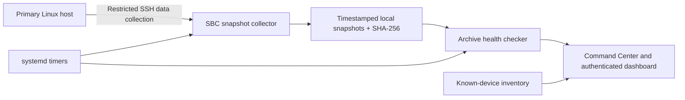

# Potato Command Center — Linux Operations, Backup Verification, and Monitoring

**Project type:** Independent homelab engineering project (AI-assisted development)  
**Role:** Project owner; requirements, integration, troubleshooting, testing, and approval-controlled changes  
**Technology:** Ubuntu/Armbian Linux, Bash, Python, systemd, SSH, SQLite-adjacent tooling, HTTP, Git, SHA-256, LAN networking  
**Status:** Core Command Center, backup workflows, portable packaging, and dashboard features have documented successful tests. The larger monitoring/recovery roadmap remains in development.

## At a glance

- **Unattended backup check:** A scheduled infrastructure snapshot completed successfully on 11/04/2026; five existing snapshots subsequently passed integrity checks.
- **Reproducible packaging:** A 25-file ARM64 release archive passed packaging and installation/removal tests. A Debian package passed isolated installation, upgrade, rollback, and removal tests.
- **Operational visibility:** An authenticated web dashboard was tested displaying Linux resource metrics, inventory, and archive-health information on a mobile browser.

These are *historical results recorded in tracked development logs*, not new test runs or evidence of a commercial deployment. See [test and verification record](../evidence/potato-command-center-verification.md).

## Problem

A collection of household Linux servers and single-board computers needed a practical way to inspect system condition, preserve configuration snapshots, distinguish failures from recoveries, and recover information after problems. The solution needed to reuse existing services, respect limited SBC resources, and avoid changing working infrastructure during experimentation.

## Approach and implementation

1. **Command-line operations:** Maintained a menu-driven utility providing inventory, network diagnostics, incident records, recovery actions, archive comparison, and backup-health reporting.
2. **Controlled snapshot collection:** Used restricted SSH access to collect primary-host information, timestamped records, SHA-256 checksums, process locking, and status logs. A separate checker evaluated snapshot integrity and freshness.
3. **Scheduling and recovery:** Configured systemd timer-based snapshot and health-check execution, tested unattended runs, and maintained protected rollback copies before modifications.
4. **Portable deployment:** Prepared ARM64 package artifacts with configurable installation inputs, preflight checks, allowlisted installation/removal behavior, and protection of user configuration and data.
5. **Read-only visibility:** Implemented a Python-backed dashboard with password authentication and read-only views for system status, known devices, archive checks, and incident history. Later monitoring work reused the existing Command Center rather than replacing it.

### Simplified architecture

*Conceptual diagram: deliberately excludes internal host addresses, credentials, and private network topology. It does not depict automatic multi-node failover.*

## A debugging example

A snapshot-retention scanner initially failed to discover existing archives because a filename-matching regular expression was double-escaped. Rather than altering the archive, the development process inspected the matching expression, corrected the scanner, and verified discovery of four existing snapshot/checksum pairs. Additional tests checked malformed timestamps, minimum-age protection, newest-snapshot protection, and protection of snapshots associated with an open incident. The retention scanner remained **read-only**: no automatic deletion was enabled.

This illustrates a useful support-engineering workflow: reproduce the issue, isolate its cause, apply a narrow fix, rerun acceptance checks, and avoid changes to irreplaceable records.

## Evidence and outcomes

| Date | Recorded verification | Scope |
| --- | --- | --- |
| 11/04/2026 | First unattended snapshot completed; five archives passed integrity checks | Historical production-homelab observation |
| 11/04/2026 | ARM64 archive and Debian package lifecycle tests passed | Isolated packaging tests |
| 11/04/2026 | Authenticated mobile dashboard displayed archive health and host metrics | Functional dashboard test |
| 11/10/2026 | Snapshot and health-watch systemd services had successful unattended executions | Scheduled service verification |
| 11/12/2026 | Command Center monitoring-status menu was verified without replacing previous options | Integration test |

[Read the detailed verification record](../evidence/potato-command-center-verification.md).

## Engineering decisions and limitations

- **Read-only by default:** Viewing inventory and health state was separated from potentially destructive maintenance actions.
- **Evidence before completion:** An HTTP response, successful command exit, or completed development step was not automatically treated as full workflow acceptance.
- **Resource-aware design:** Reused working tools on low-resource SBCs instead of adding broad infrastructure unnecessarily.
- **Explicit boundaries:** The broader network monitoring and multi-node recovery plans remain incomplete. Automatic failover is **not** claimed. Unattended outage/recovery notifications in the newer monitoring work were not fully accepted in the provided roadmap.
- **Ownership transparency:** The project used AI-assisted code development and review. The owner directed requirements, testing, troubleshooting, integration, and final acceptance; not all code is claimed as independently authored.

## What I would show in an interview

I can explain the backup collection path, why restricted SSH matters, how checksum and retention safeguards differ, the regex discovery failure, how systemd timer execution was verified, and why isolated package lifecycle tests precede deployment.

**Publication note:** This page summarizes private development records. It intentionally excludes raw configuration, private IPs, passwords, host keys, internal logs, and household identities.
