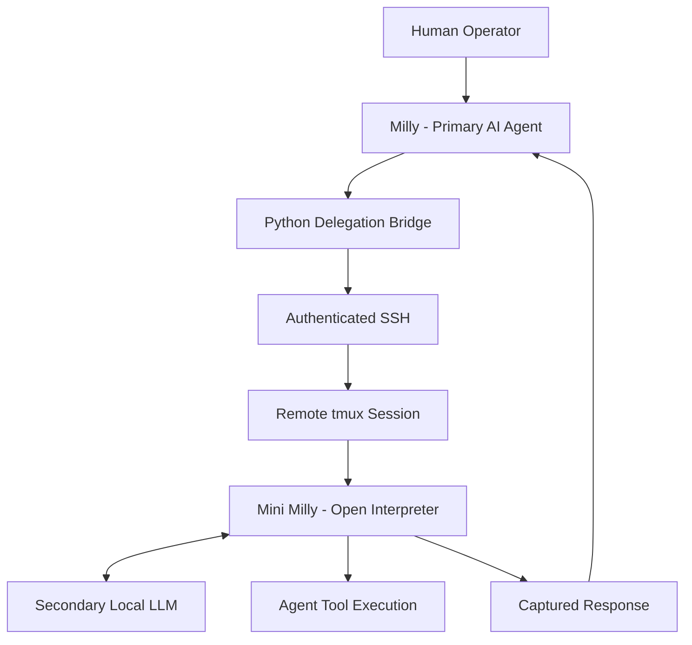

# Evidence 03 — Multi-Agent Delegation Verification

**Project:** Project Milly  
**Developer:** Kevin Mays  
**Evidence Period:** October 2026  
**Status:** Historical integration tests documented  
**Technologies:** Python, Ubuntu Linux, SSH, tmux, Open Interpreter, KoboldCpp, Local LLMs

---

## 1. Overview

This document summarizes the historical integration tests performed during development of Project Milly's multi-agent delegation system.

The system connects two independently running, locally hosted AI agents:

- **Milly:** Primary AI assistant.
- **Mini Milly:** Secondary AI assistant operating in a separate Ubuntu environment.

The objective was to enable the primary assistant to delegate instructions to a secondary tool-capable agent and retrieve its responses.

The implementation uses Python, authenticated SSH communication, and persistent tmux sessions.

---

## 2. System Architecture

*Simplified architecture. Internal network addresses and authentication details are intentionally excluded.*

---

## 3. Documented Integration Tests

Historical development records document the following results:

| Test | Documented Result |
|---|---|
| Secondary language model API connectivity | PASS |
| Communication between Linux environments | PASS |
| SSH authentication | PASS |
| Remote tmux session interaction | PASS |
| Agent-to-agent instruction submission | PASS |
| Response capture and retrieval | PASS |
| Secondary agent Linux command execution | Demonstrated |
| Delegation initiated through Milly | User-confirmed successful |
| SSH agent authentication fallback | Successfully tested |

These results were documented during development in October 2026.

They represent successful outcomes for the specific scenarios tested.

---

## 4. End-to-End Delegation

The integration workflow was designed to:

1. Receive a delegation request from the primary agent.
2. Establish an authenticated connection to the secondary environment.
3. Locate the secondary agent's persistent interactive session.
4. Submit an instruction.
5. Monitor the session for a response.
6. Capture the resulting output.
7. Return the response to the primary agent.

Historical testing demonstrated successful instruction delivery and response retrieval.

The integrated workflow was confirmed working by the project owner.

---

## 5. Tool Execution Verification

A critical development objective was ensuring that Mini Milly could execute actual tools rather than merely generate text resembling commands.

Testing demonstrated Linux command execution through Mini Milly's Open Interpreter environment.

This established a distinction between:

- **Model communication:** Receiving a text response from a language model.
- **Agent delegation:** Sending instructions to an AI agent capable of interacting with tools.

The documented tests demonstrated basic functional agent delegation.

---

## 6. Engineering Challenges

### Model and Tool Compatibility

Development testing identified compatibility issues involving structured tool calls.

Configuration adjustments were evaluated until actual tool execution was demonstrated.

### Remote Session Management

The delegation system needed to interact with an existing Open Interpreter session.

Using tmux allowed the integration to communicate with the persistent agent environment.

### Authorization Boundaries

The delegation workflow was developed within the project's existing human-authorization model.

The system was not intended to provide unrestricted remote execution.

### Verification of Agent Responses

Receiving terminal output confirms that communication occurred.

It does not independently verify the correctness of every claim made by a responding AI agent.

Additional verification remains necessary for complex delegated tasks.

---

## 7. Results

The documented implementation demonstrated:

- Communication between independently running local AI agents.
- Authenticated SSH connectivity.
- Interaction with a persistent remote agent session.
- Instruction submission and response retrieval.
- Actual tool execution by the secondary agent.
- Integration with the primary assistant's delegation workflow.

These results established a foundation for further experimentation with distributed AI agent systems.

---

## 8. Verification Limitations

The historical tests do not establish:

- Reliable autonomous multi-step software development.
- Comprehensive concurrent delegation.
- Guaranteed correctness of delegated responses.
- Complete recovery from remote failures.
- Production-grade distributed task management.

The system remains an experimental integration under continued development.

---

## 9. Engineering Skills Demonstrated

This project provides evidence of experience with:

- Multi-agent AI integration.
- Local LLM infrastructure.
- Python automation.
- SSH authentication.
- Linux system administration.
- Remote session management with tmux.
- Open Interpreter tool execution.
- Troubleshooting model compatibility.
- Integration testing.
- Human-controlled automation.

---

## Related Documentation

[Case Study 02 — Multi-Agent Collaboration](../case-studies/multi-agent-collaboration.md)

---

**Kevin Mays**  
Independent AI Systems Developer  
Project Milly — Active Development
